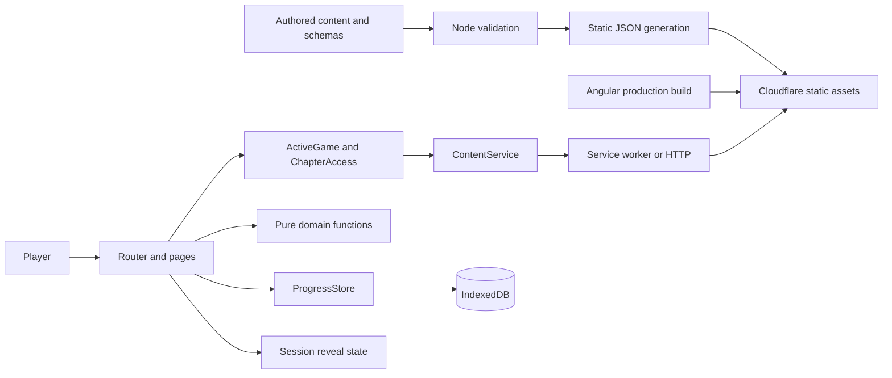
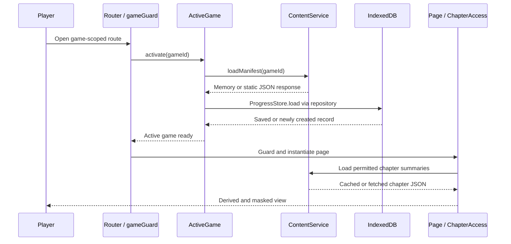
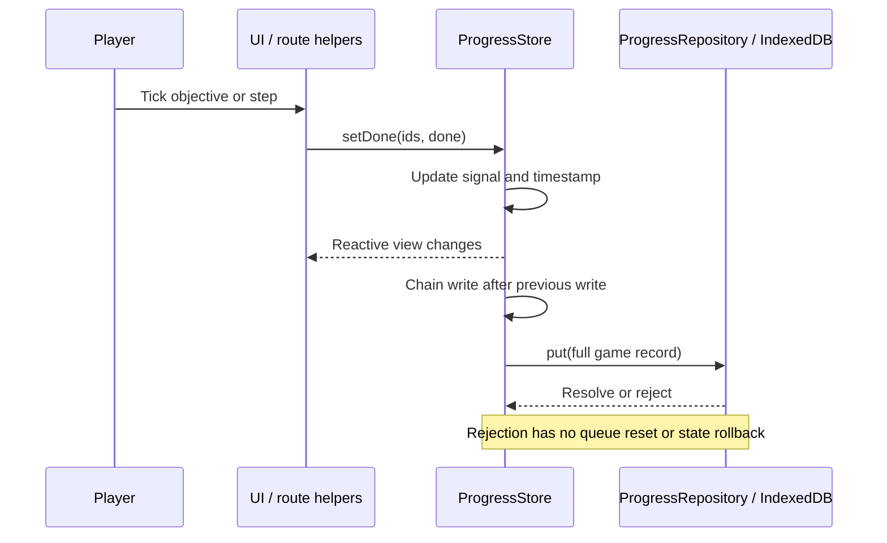
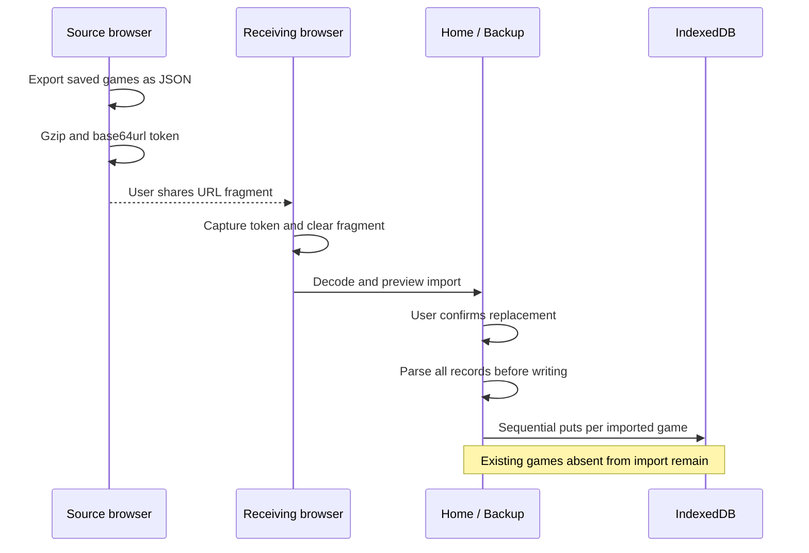
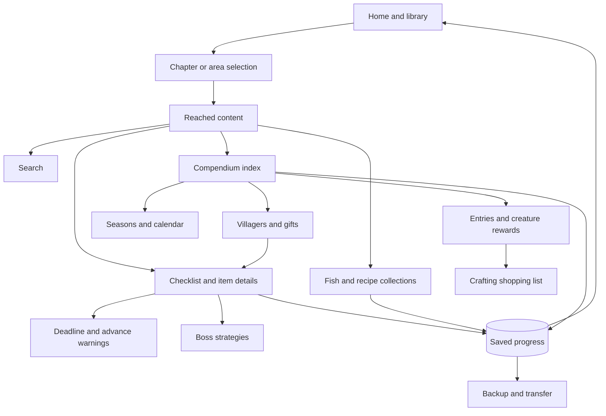

# Chaptick — Codebase Knowledge

## Scope and evidence

**Phases 1–3 complete: initial context scan, system architecture deep dive and feature analysis. Phases 4–6 have not been performed.** This is the master document to extend in later phases, not a claim of a completed system audit. Snapshot: 2026-10-07. Analysis used local source, configuration, content structure, selected test bodies, Phase 2 call-site tracing, and Phase 3 component/template/feature tracing. No application code changed; no application tests or browser checks were run.

All paths are relative to the repository root. Stable references use `[[F:path#line-range#hash]]`, where hash is the first eight SHA-256 digits of the complete file. Full-file anchors identify the evidence artifact; they do not mean every line was read. The complete 258-file baseline inventory is in `codebase-analysis-docs/assets/FILE_INDEX.md`. Dependencies, `.git`, `.wrangler`, build output, Angular caches, and generated public content are excluded from the source inventory. No repository `AGENTS.md` was found in the initial search.

**Decisions/Findings:** implementation and authored data take precedence over older README scope. **Open Questions:** runtime edge cases and complete feature internals remain for later phases. **Next Steps:** use the ordered read queue below.

## High-level overview

Chaptick is an unofficial, mobile-oriented game companion for players who want to complete quests, avoid permanently missable content, and find game information without accidentally seeing future story or area content. Players manually choose their current chapter or reached area, consult a checklist or compendium, and record completion on their device. It is designed to sit beside the game on a phone; it does not read a game save or automatically detect in-game progress. The intended use is evidenced by `README.md`, `web/playwright.config.ts`, `ActiveGame`, `ChapterAccess`, and `ProgressStore`.

Its business purpose is player assistance: reduce missed objectives, repeated guide searching, and accidental spoilers. The repository describes a fan project, not a paid subscription product. `web/src/app/site.config.ts` currently has no donation links and no canonical-domain migration destination, while production-host Umami analytics is configured. Code and authored content have separate licenses (`LICENSE`, `LICENSE-CONTENT`; see `CONTRIBUTING.md`).

### Current authored coverage

Counts below are stored records, not a promise of complete coverage of the games. They were computed from `content/<game>/chapters/*.json`; names and progress terminology come from each `content/<game>/game.json`.

| ID | Game | Chapters/areas | Checklist items | Other authored content |
| --- | --- | ---: | ---: | --- |
| `fc` | Trails in the Sky 1st Chapter | 5 chapters | 147 | 68 recipes |
| `sc` | Trails in the Sky 2nd Chapter | 8 chapters | 156 | 22 fish; 61 recipes |
| `wte` | Welcome to Elderfield | 5 areas | 83 | 1,198 entries; 611 crafts; 113 creatures; 9 villagers; 6 events |
| `ysx` | Ys X: Proud Nordics | 12 chapters | 94 | 33 fish; 24 recipes |

`README.md` still introduces only Trails in the Sky 2nd Chapter. `CONTRIBUTING.md` and the correction example in `docs/deploy.md` also use SC-specific paths. The implemented model is franchises → games → chapters, and the term “chapter” in code also represents ordered areas (`Game.progressTerm`). Do not hardcode SC assumptions into new features.

### Main features and their business purposes

| Feature | Player/business purpose | High-level behavior and connections | Evidence |
| --- | --- | --- | --- |
| Home, library, and resume | Find supported games and return quickly to an ongoing playthrough | Catalog groups games by franchise; home loads saved games and summarizes current progress. Game activation switches both manifest and progress record. | `pages/home/home.ts`: `Home`; `pages/library/library.ts`; `core/game/active-game.ts`: `ActiveGame.activate` (all under `web/src/app/`) |
| Chapter/area selection and spoiler protection | Match guidance to the player's actual position without disclosing future content | Chapter order determines unlocked content; guarded chapter/item/boss routes reject future links. Spoiler levels additionally mask sensitive text inside unlocked chapters. | `web/src/app/core/spoiler/chapter-access.ts`: `ChapterAccess`, `unlockedChapterGuard`; `web/e2e/checklist.e2e.ts` |
| Checklist, routes, and trophy filtering | Prevent missed quests/collectibles and support completion goals | Four item types: quest, hidden quest, missable, collectible. Filters, completion totals, optional route steps, and trophy associations share saved progress. | `web/src/app/pages/checklist/checklist.ts`: `Checklist`; `web/src/app/core/content/content.models.ts`: `Item`, `Trophy`; `web/e2e/route.e2e.ts`, `web/e2e/trophies.e2e.ts` (test names surveyed) |
| Deadlines and advance warnings | Warn before objectives become unavailable | Items reference checkpoints via `availableUntil`; checklist computes upcoming alerts, still-open earlier items, and expired earlier items. Advancing uses confirmation UI. | `web/src/app/pages/checklist/checklist.ts`: `alert`, `carried`, `leftBehind`; `web/src/app/core/spoiler/spoiler.ts`; `web/e2e/advance.e2e.ts`, `web/e2e/deadlines.e2e.ts` (test names surveyed) |
| Item and boss guidance | Give actionable help while preserving intentional reveals | Item details expose hints, community text, and routes; associated boss strategies connect to checklist objectives. Bosses are separate from checklist completion. | `web/src/app/app.routes.ts`; `web/src/app/core/content/content.models.ts`: `ItemText`, `Boss`; `web/e2e/detail.e2e.ts`, `web/e2e/collections.e2e.ts` (test names surveyed) |
| Fish and recipe collections | Track collection goals across chapters | Aggregates only reached content, includes fishing spots/ranks and recipe sources; Rank A implies caught. Collection trophies attach to the relevant tab. | `web/src/app/pages/collections/collections.ts`: `Collections`, `toggleCaught`, `toggleRankA` |
| Compendium and detail pages | Answer where to obtain materials, equipment, ingredients, and creature rewards | Builds a reached-content index with entries, sources, crafts, and creatures. Later reached areas can add acquisition sources for earlier entries. | `web/src/app/pages/compendium/compendium.ts`: `Compendium`; `web/src/app/core/content/content.models.ts`: `Entry`, `EntrySource`, `Craft`, `Creature` |
| Crafting shopping list | Reduce manual calculation and support make-versus-buy choices | Select quantity, expand ingredient recipes, and aggregate gathering totals. Quantity is in the URL; ingredient choices and “already have” marks are local to the page visit. | `web/src/app/pages/plan/plan.ts`: `Plan`; `web/e2e/compendium.e2e.ts` shopping-list test |
| Seasons, calendar, gifts, and friendship | Plan time-limited gathering and social progression | Compendium exposes seasonal availability, dated/weekly events, villager tastes, and heart milestones. Villagers can link to checklist adventures; entry pages show gift reactions. | `web/src/app/pages/compendium/compendium.ts`; `web/src/app/core/content/content.models.ts`: `Villager`, `GameEvent`; `web/e2e/compendium.e2e.ts` |
| Search and local naming | Find relevant guidance despite translation/name differences | Home searches games and reached content of started games; compendium supports names saved by the player. Per-game search has its own route. | `web/src/app/pages/home/home.ts`: `contentHits`, `gameHits`; `web/src/app/core/progress/progress.store.ts`: `setName`; `web/e2e/compendium.e2e.ts` name test |
| Local persistence, backup, and transfer | Retain progress without accounts and move it between devices/domains | One IndexedDB record per game; JSON export/import and compressed URL-fragment links carry all saved games. Incoming links require UI confirmation before import. | `web/src/app/core/progress/progress.repository.ts`; `web/src/app/core/progress/progress.store.ts`; `web/src/app/core/progress/transfer.service.ts`; `web/src/app/pages/home/home.ts`: `confirmImport` |
| Offline use and bilingual UI | Keep guidance accessible beside the game, including disconnected sessions | Production service worker prefetches shell/translations and caches fetched content. English/Portuguese UI uses Transloco; localized data falls back to English. | `web/ngsw-config.json`; `web/src/app/app.config.ts`; `web/src/app/core/content/content.models.ts`: `localize` |
| Content corrections and attribution | Maintain trustworthy community guidance | Authored JSON records sources; schema/reference validation runs before generation. Issue templates support corrections; credits and privacy pages are routed. | `CONTRIBUTING.md`; `scripts/content-validation.mjs`; `.github/ISSUE_TEMPLATE/`; `web/src/app/app.routes.ts` |

### How features work together

The catalog first identifies a game and its capabilities. `ActiveGame.activate()` loads its manifest and saved progress. `ChapterAccess` turns the saved chapter into an ordered set of reachable chapters. Checklists, collections, and compendium then consume that reached content. Checklist completion feeds resume summaries and remaining-objective warnings; trophy metadata helps prioritize objectives. Compendium entries connect acquisition sources, crafting plans, creature rewards, and gifts. Search is another view of the same progression-limited information. `ProgressStore` persists completion and preferences; transfers move those records to a different browser origin or device.

Spoiler avoidance has two layers: avoid fetching future chapter files during normal app navigation, and mask sensitive text in reached chapters. This is a UX boundary, not server-side authorization: chapter JSON is deployed as public static assets. `ContentService.loadChapter()` itself trusts its caller; `ChapterAccess.loadChapter()` also delegates without independently rechecking order. New consumers must preserve the access convention. See `web/src/app/core/content/content.service.ts` and `web/src/app/core/spoiler/chapter-access.ts`.

**Decisions/Findings:** progression and shared content are the central feature dependencies. **Open Questions:** Phase 2 identifies cached-deadline and resource-identity boundaries (section 2.6); Phase 3 identifies additional presentation gaps (sections 3.8, 3.11 and 3.13); browser scenarios remain unexecuted. **Next Steps:** trace all consumers that fetch chapters or reuse loaded data.

## Mid-level technical notes

### Stack and architecture

This is a client-rendered static Angular single-page application, organized into route pages, shared UI, injectable state/data services, and domain functions. There is a separate Node content build/validation toolchain and Python authoring helpers. No custom request backend, server database, login service, background job system, or live game integration was found in the mapped runtime. Cloudflare Workers is configured to serve static assets with SPA fallback (`wrangler.jsonc`).

| Concern | Repository-declared technology | Source |
| --- | --- | --- |
| Frontend | Angular dependencies mostly `^22.1.0`; service worker `^22.2.1`; standalone bootstrap, lazy routes, signals/computed/resource, OnPush components | `web/package.json`; `web/src/main.ts`; `web/src/app/app.routes.ts`; page components |
| Languages | TypeScript, HTML, SCSS; Node ESM `.mjs`; Python authoring; JSON data/schema/config; YAML CI | `codebase-analysis-docs/assets/FILE_INDEX.md` |
| State/storage | Angular services and signals; `idb ^8.0.3` over IndexedDB | `web/package.json`; `ProgressStore`; `ProgressRepository` |
| Data requests | Angular HttpClient with Fetch; RxJS `~7.8.0` and `firstValueFrom` | `web/src/app/app.config.ts`; `ContentService` |
| Translation | Transloco `^8.4.0`, English/Portuguese resources, content-localization helpers | `web/package.json`; `web/public/i18n/`; `app.config.ts` |
| Content validation | Ajv `8.20.0`, ajv-formats `3.0.1`, JSON Schema 2020 validator | `package.json`; `scripts/content-validation.mjs` |
| Build/test | Angular CLI/build `^22.1.2`, TypeScript `~6.0.2`, Vitest `^4.0.8`, Playwright `^1.62.1`, axe, fake-indexeddb | `web/package.json`; `web/angular.json`; `web/playwright.config.ts` |
| Hosting/CI | Cloudflare static assets; GitHub Actions using Node 24 | `wrangler.jsonc`; `.github/workflows/ci.yml` |
| Fonts/analytics | Bundled Fontsource families; optional host-gated Umami script | `web/package.json`; `web/src/app/site.config.ts`; `AnalyticsService.init` |

Versions above are manifest requirements, not a claim about current upstream releases or installed resolutions. Root and `web/` have separate package manifests and lockfiles. The root package handles content; `web/` handles the application.

### Directory map

```text
content/                    Authored franchises, game metadata, chapters, ID registry
  schema/                   JSON schemas; counterpart of content.models.ts
scripts/                    Node validation and static content generation
  authoring/                Python source-authoring helpers and datasets
tests/                      Node content-validator tests and fixtures
web/
  src/main.ts               Browser bootstrap
  src/app/app.config.ts     Router, HTTP, translation, SW and initialization
  src/app/app.routes.ts      Global and game-scoped routes
  src/app/core/             Content, progress, spoiler, search, compendium domain code
  src/app/pages/            Routed feature components with templates/styles
  src/app/ui/               Shared controls, cards, reveal and confirmation UI
  public/                   Icons, i18n, manifest, headers, generated content/
  e2e/                      Playwright tests, static test server and fixture content
.github/                    CI and correction issue templates
docs/                       Hosting/deployment instructions
codebase-analysis-docs/     This analysis and continuation artifacts
```

### Backbone files read first and findings

1. `README.md`, `CONTRIBUTING.md`, package manifests: initial product intent, ownership and commands; README is narrower than implementation.
2. `web/src/main.ts`, `app.config.ts`, `app.routes.ts`: bootstrap `App`; capture incoming transfers before routing; initialize catalog/language; lazy-load feature pages under global and `:gameId` routes.
3. `content.models.ts`, game metadata and chapter structure: localized content contracts and optional per-game feature domains. Source filename `ch-00.json` becomes generated `ch-0.json`.
4. `ContentService`: loads `/content/catalog.json`, per-game manifest, and versioned chapter URLs; caches manifest/chapter promises and deletes failed entries for retry.
5. `ActiveGame` and `ChapterAccess`: bind route game to its progress and compute permitted content. Manifest-derived capabilities control feature visibility; old manifests have compatibility defaults.
6. `ProgressRepository`, `ProgressStore`: IndexedDB database `chaptick`, version 1, object store `progress` keyed by `gameId`; serialized writes, signal state, export/import, preferences, and best-effort browser persistent-storage request.
7. `scripts/build-content.mjs`: validates first, replaces generated output, derives catalog/features/counts, writes manifests and separate chapter payloads. `scripts/content-validation.mjs` entry points and selected checks were read; Phase 2 subsequently traced its cross-reference and registry checks (section 2.3).
8. Home/checklist/collections/compendium/planner components and selected E2E bodies: confirm main user workflows and shared progression dependencies. Other E2E test names were surveyed to locate later evidence.
9. Service-worker, deployment, transfer and analytics files: static hosting and cached browser runtime; account-free transfer; analytics script restricted by configured hostname.

### Build and verification entry points

From repo root: `npm ci`, `npm run content:validate`, `npm run content:build`, `npm run test:content`. From `web/`: `npm ci`, `npm start`, `npm run test:ci`, `npm run build`, `npm run e2e`. See both package manifests and `.github/workflows/ci.yml`.

Content generation must precede serving the real application. `web/public/content/` is generated and ignored; edit `content/` instead. E2E configuration generates fixture content in `web/e2e/.content`, builds the application, and starts `web/e2e/serve.mjs`; fixtures must not be mistaken for real coverage. The configured browser project emulates Pixel 7. Phase 2 confirmed that offline-specific tests override service-worker blocking and verify the cached visited chapter; see section 2.4.

`validate-content.mjs` compares the ID registry against `origin/main` by default, but explicitly skips the append-only comparison with a warning if that reference cannot be read. Content IDs underpin existing saved progress and must remain stable. Content corrections also require bumping the affected game's `dataVersion`, since chapter requests use `?v=<version>` (see `ContentService.loadChapter`, `CONTRIBUTING.md`, `docs/deploy.md`).

**Decisions/Findings:** keep source data, generated assets, and local user progress distinct. **Open Questions:** full schema invariants, resource invalidation, persistence-failure handling and offline update behavior. **Next Steps:** Phase 4 risk consolidation; tests appropriate to any later code changes. No test pass is claimed by this documentation-only scan.

## Deep reference starter (expanded in later phases)

### Domain glossary

| Term | Meaning and source |
| --- | --- |
| Franchise | Library grouping of games (`Catalog`, `Franchise` in `content.models.ts`). |
| Chapter | Ordered content/progression boundary; may represent an area (`Game.progressTerm`). |
| Manifest | Per-game metadata, capabilities, totals and neutral chapter summaries; not chapter payloads (`Manifest`, `build-content.mjs`). |
| Checkpoint | Ordered point-of-no-return description referenced by an item's deadline (`Checkpoint`, `Item.availableUntil`). |
| Item | Trackable quest, hidden quest, missable, or collectible; distinct from a compendium entry (`Item`). |
| Entry | Obtainable compendium entity such as material, food, tool or equipment (`Entry`). |
| Craft | Recipe/process linking ingredient quantities to an optional output entry (`Craft`). |
| Collection | Fish/recipe tracking domain, distinct from general compendium categories (`Collections`). |
| Spoiler level | 0: visible; 1: sensitive text behind reveal; 2: safe hint plus confirmed reveal (`CONTRIBUTING.md`, `web/e2e/checklist.e2e.ts`). |
| Progress | Per-game current chapter, completion IDs, preferences and timestamp (`SavedProgress`). |
| Data version | Content revision used in chapter URL cache keys (`Game.dataVersion`, `ContentService.loadChapter`). |

### Assumptions and limits

| Statement | Confidence | Basis / needed confirmation |
| --- | --- | --- |
| Mobile companion players are the primary users | High | README and Pixel 7 E2E configuration. |
| Current architecture is intentionally static and account-free | High | Deployment config, README, IndexedDB repository, routed client implementation. |
| Every feature preserves masking under all navigation/state changes | False as a blanket source-level claim | Phase 3 identified home-result, creature-detail and adventure-link gaps; see sections 3.8, 3.11 and 3.13. Browser reproduction remains pending. |
| Authored content covers every objective in supported games | Unknown | Record counts establish repository coverage only; external game facts were not checked. |
| Python scripts are safe to rerun without losing edits | Unverified | `scripts/authoring/lib.py` `Chapter.load()` clears several optional collections; inspect individual scripts before execution. |

### Initial risks to carry forward

- Stable IDs and mirrored JSON/TypeScript contracts are compatibility boundaries. Do not rename IDs or edit one contract without checking the other (`content/id-registry.json`, `content/schema/`, `content.models.ts`).
- Chapter loading relies on callers following progression rules; public static URLs are not access-controlled (`ContentService`, `ChapterAccess`).
- IndexedDB is tied to browser/origin; device clearing or origin changes make backup/transfer important (`ProgressRepository`, `TransferService`, `docs/deploy.md`).
- `ProgressStore.persist()` chains writes without a visible recovery catch; investigate failure propagation before changing persistence. This is an inspection lead, not a reproduced bug.
- Cached chapters can remain in memory after progress changes; inspect consumers rather than assuming `ContentService.loaded` always reflects the current boundary.
- The manifest cache has `maxSize: 5`, currently matching one catalog plus four game manifests; assess eviction behavior when expanding coverage (`web/ngsw-config.json`).

**Decisions/Findings:** these are initial compatibility constraints and investigation leads, not a complete gotcha/security audit. **Open Questions:** verify each lead in its runtime context. **Next Steps:** expand this section in Phases 4–5.

## Phase 2 — System architecture deep dive

Evidence ledger: `codebase-analysis-docs/assets/PHASE2_EVIDENCE.md` records source chunks and stable anchors for this phase.

### 2.1 System boundaries and component map

The runtime is a browser application backed by static files. There is no application API server between the player and their saved progress. The closest equivalents to backend services are the browser's injectable services; the durable user database is IndexedDB. The Node validation/build tools run before deployment, not on player requests. `wrangler.jsonc` serves `web/dist/web/browser` with single-page fallback; `web/src/main.ts` bootstraps the browser application.



Diagram source: `codebase-analysis-docs/assets/architecture.mmd`. Arrows show dependencies/data exchange, not a custom server deployment.

| Component | Responsibility and collaborators | Implementation |
| --- | --- | --- |
| Application shell and initialization | Registers router, HTTP, translations and production SW; captures incoming transfer before navigation; waits for catalog and language initialization. Shell exposes navigation, update/domain-move banners and router outlet. | `web/src/app/app.config.ts`: `appConfig`; `web/src/app/app.ts`: `App`; `web/src/app/app.html` |
| Routing and active context | Global home/library/backup/credits/privacy routes plus `:gameId` children. `gameGuard` activates known games; unknown games redirect to `/`. `ActiveGame` joins catalog/manifest capabilities to active progress. | `web/src/app/app.routes.ts`; `web/src/app/core/game/active-game.ts` |
| Content transport | Fetches static catalog/manifests/chapters; shares pending requests; publishes loaded data as readonly signals. Does not enforce access or validate HTTP JSON at runtime. | `web/src/app/core/content/content.service.ts`: `ContentService` |
| Progression policy | Resolves current chapter (first chapter fallback), computes unlocked summaries, provides chapter loader and guards for chapter/item/boss URLs. | `web/src/app/core/spoiler/chapter-access.ts`: `ChapterAccess`, `unlockedChapterGuard` |
| Persistent state | Holds the active game's signal state, serializes writes, lists all saves, parses and imports/exports snapshots. Repository owns database operations. | `web/src/app/core/progress/progress.store.ts`: `ProgressStore`; `web/src/app/core/progress/progress.repository.ts`: `ProgressRepository` |
| Cross-game projection | Reloadable view of catalog-known saved games. Home resume and global search load each game's content independently of `ActiveGame`. | `web/src/app/core/game/saved-games.ts`: `SavedGames`; `web/src/app/core/search/global-search.ts`: `GlobalSearch`; `web/src/app/pages/home/home.ts` |
| Spoiler presentation | Shared session-only reveal set plus item visibility/trophy/deadline rules. UI components apply tap/confirmation and conditional text rendering. | `web/src/app/core/spoiler/reveal.service.ts`; `web/src/app/core/spoiler/item-view.ts`; `web/src/app/ui/spoiler-reveal/spoiler-reveal.ts` |
| Pure domain computations | Derive deadline groups, completion, search hits, collection books, compendium reverse links, ingredient trees and seasonal/calendar views from passed data. No independent network or persistence access. | `web/src/app/core/spoiler/spoiler.ts`, `web/src/app/core/spoiler/deadlines.ts`, `web/src/app/core/search/search.ts`, `web/src/app/core/collections/collections.ts`, `web/src/app/core/compendium/`, `web/src/app/core/route/route.ts` |
| Feature orchestration | Routed components load data with `resource`, derive view models with `computed`, and pass user actions to shared stores. Shared UI contains domain-aware controls as well as presentation. | `web/src/app/pages/`; `web/src/app/ui/advance-confirm/advance-confirm.ts`; `web/src/app/ui/route-steps/route-steps.ts` |
| Runtime maintenance | Checks for SW updates, manages transfer links, tracks configured aggregate analytics, and applies language choice. | `web/src/app/core/pwa/app-update.service.ts`; `web/src/app/core/progress/transfer.service.ts`; `web/src/app/core/analytics.service.ts`; `web/src/app/core/i18n/lang.service.ts` |

**Decisions/Findings:** this is a layered, content-driven client application with pure domain helpers, rather than a server/controller architecture. **Open Questions:** same-component route reuse and concurrent activation deserve runtime tests. **Next Steps:** use the flows below to locate the correct change boundary.

### 2.2 Read, write, search and transfer flows

#### Startup and game-scoped reads

`bootstrapApplication(App, appConfig)` starts the app. The initializer calls `TransferService.captureIncoming()`, initializes analytics, then awaits catalog and language in parallel. `gameGuard` calls `ActiveGame.activate(gameId)`: validate catalog membership, reuse an already active game, otherwise load its manifest, await `ProgressStore.load()`, then publish the active ID. Progress loading waits for outstanding writes before reading IndexedDB; a first visit writes a new record immediately. See `web/src/main.ts`, `web/src/app/app.config.ts`, `web/src/app/core/game/active-game.ts`, `web/src/app/core/progress/progress.store.ts`.



Diagram source: `codebase-analysis-docs/assets/chapter-read.mmd`.

Chapter, item and boss routes use `unlockedChapterGuard`; item/boss owner chapters are extracted from their IDs. Entry, creature and craft-plan routes instead look up the requested ID in an index constructed only from unlocked chapters; unknown/future entities are absent. `ContentService` serves three read contracts: `/content/catalog.json`, `/content/<gameId>/manifest.json`, and `/content/<gameId>/<summary.file>?v=<dataVersion>`. Responses are typed using TypeScript interfaces, with validation trusted to the build pipeline. Sources: `web/src/app/app.routes.ts`, `web/src/app/core/spoiler/chapter-access.ts`, `web/src/app/core/content/content.service.ts`, `web/src/app/pages/entry/entry.ts`, `web/src/app/pages/creature/creature.ts`, `web/src/app/pages/plan/plan.ts`.

For aggregate pages, `ChapterAccess.loadUnlocked()` fetches all summaries up to the current order with `Promise.all`. `compendiumIndex()` sorts chapters, builds entries and crafts, then reverse maps (`madeBy`, `usedIn`, `givenBy`) and gifts/events/checklist links. Unlinked reward names can resolve by exact English name once a matching entry is reached. Each consuming component builds its own computed index; this is not a single global search database. Sources: `web/src/app/core/spoiler/chapter-access.ts`, `web/src/app/core/compendium/compendium.ts`.

#### Progress writes and advancement



Diagram source: `codebase-analysis-docs/assets/progress-write.mmd`.

`ProgressStore.update()` publishes a new snapshot before persistence completes. `persist()` serializes full-record `put()` operations through one promise chain. Route steps and collection rank flags use synthetic IDs in `doneItems`, such as `<itemId>#step-1` and `<fishId>#rank-a`; shared helpers keep the parent objective consistent. `SavedGames.doneCount()` excludes `#` flags from its display count. Sources: `web/src/app/core/progress/progress.store.ts`, `web/src/app/core/route/route.ts`, `web/src/app/core/collections/collections.ts`, `web/src/app/core/game/saved-games.ts`.

`Where.choose()` saves the selected chapter before navigating. First-time picking can jump directly to the player's existing position; otherwise the advance UI computes `newlyLeftBehind()` from currently loaded/reached chapters. `AdvanceConfirm.confirm()` records analytics, awaits `setChapter()`, and navigates. There is no stored in-chapter checkpoint cursor: deadline alerts derive from pending items and checkpoint order, while expiration comparisons use chapter order. Sources: `web/src/app/pages/where/where.ts`, `web/src/app/ui/advance-confirm/advance-confirm.ts`, `web/src/app/core/spoiler/spoiler.ts`, `web/src/app/core/progress/progress.models.ts`.

#### Home/global search

`SavedGames.reload()` increments a signal that reloads records from `ProgressStore.listSaved()` and filters out games absent from the catalog. Home resume loads the current chapter of each saved game. When the query is long enough, `GlobalSearch.reached()` loads manifests and reached chapters for each saved record without modifying `ActiveGame`. `search()` combines visibility-filtered checklist search, compendium entries, creatures and villagers; per-kind display caps are separate from the underlying search cap. Name/location fields are omitted while masked; level-2 safe hints and steps remain searchable by the shared hint rule. Sources: `web/src/app/core/game/saved-games.ts`, `web/src/app/pages/home/home.ts`, `web/src/app/core/search/global-search.ts`, `web/src/app/core/search/search.ts`.

#### Backup/import and domain migration



Diagram source: `codebase-analysis-docs/assets/progress-transfer.mmd`.

`TransferService.createLink()` exports all saved games compactly. `encodeTransfer()` emits gzip/base64url with `z` prefix, or uncompressed base64url with `j` prefix when compression is unavailable. Receiving initialization captures `#transfer=...` and removes it from the address bar before router/analytics initialization. Home decodes and parses to preview game names, then waits for explicit UI confirmation. File backup uses a downloaded JSON Blob; file import similarly stages text before confirmation. Sources: `web/src/app/core/progress/transfer.service.ts`, `web/src/app/core/progress/transfer-link.ts`, `web/src/app/pages/home/home.ts`, `web/src/app/pages/backup/backup.ts`.

`parseExport()` accepts current multi-game and legacy single-game structures, rejects higher schema versions, deduplicates completion IDs, preserves unknown IDs and merges preference defaults. `importJson()` parses all records before starting writes, then replaces each supplied game's record without deleting absent games. Those puts are not one cross-game transaction: a storage error can leave earlier records imported. Transfer links are encoded/compressed, not encrypted or authenticated; anyone with a link can decode its progress. No server synchronization is implemented. Sources: `web/src/app/core/progress/progress.store.ts`, `web/src/app/core/progress/progress.repository.ts`, `web/src/app/core/progress/transfer-link.ts`.

**Decisions/Findings:** content reads and user writes have different trust and failure boundaries. **Open Questions:** cancellation, import size limits and multi-tab concurrent writes are not implemented in these paths; user-visible failure behavior needs scenario testing. **Next Steps:** preserve these distinctions during feature-level analysis.

### 2.3 Build pipeline and data contracts

`loadContent()` discovers game directories under `content/` except `schema`. `validateContent()` checks schemas, franchise membership, game ID/folder agreement, chapter ID/order conventions, trophies and cross-references. `build-content.mjs` validates, replaces its output directory, derives feature flags/counts and writes the catalog, manifests and chapter files. Angular's public-assets configuration includes those generated files in the production output. CI runs content tests/validation/build followed by web unit tests/build/E2E. Sources: `scripts/content-validation.mjs`, `scripts/build-content.mjs`, `web/angular.json`, `.github/workflows/ci.yml`.

Key contract asymmetries in `scripts/content-validation.mjs`:

- Item deadlines may point to same/later chapter checkpoints; boss associations and fishing spots must refer to same/earlier known entities.
- Compendium entry references and villager adventure links must resolve to same/earlier content. This supports safe indexing without loading future files.
- `entityIds()` includes items, bosses, fish and recipes. `crossChapterErrors()` adds chapters/checkpoints; game IDs join these for registry validation. Compendium entities (entries/crafts/creatures/villagers/events) are checked for per-game uniqueness separately, but **are not included in the append-only registry validation**.
- Registry comparison checks that historical IDs are still present, not their array position or semantic meaning. The “never reuse” rule also requires author discipline.
- JSON Schema and `web/src/app/core/content/content.models.ts` are maintained separately; there is no inspected generator deriving one from the other.

Manifest game metadata includes trophies and descriptions, not just numeric counts; chapter payloads remain separate. “Counts-only manifest” comments should be understood as a chapter-content boundary, not a guarantee that every manifest field is numeric or neutral. See `scripts/build-content.mjs`, `web/src/app/core/content/content.models.ts`.

**Decisions/Findings:** content validation is a runtime prerequisite and provides only the invariants explicitly implemented. **Open Questions:** complete schema edge cases and authoring/regeneration behavior belong to Phases 3–5. **Next Steps:** require explicit compatibility review for new identifiers or cross-reference types.

### 2.4 State ownership and caching

| State/cache | Owner, scope and invalidation | Consequence for changes |
| --- | --- | --- |
| Catalog and manifests | `ContentService`: catalog signal; manifest promise map keyed by game; failures remove cached manifest promise | Successful manifests remain in memory until app reload; no periodic in-memory manifest refresh. |
| Chapters | `ContentService`: promise map and loaded signal keyed by chapter ID; failures delete promise; URL carries data version | Chapter cache key itself excludes version; backward progress and game switches do not clear already loaded chapters. |
| Persistent gameplay | `ProgressRepository`: IndexedDB `chaptick`, DB version 1, `progress` store keyed by `gameId`; `ProgressStore` active snapshot | One record per game; no subscriptions for other-tab database changes or conflict merge in inspected services. |
| Saved-game projection | `SavedGames`: resource keyed by explicit reload counter | Home/library must request refresh; it is not automatically derived from every progress mutation. |
| Reveals | `RevealService`: root service signal set | Survives navigation/game switches within the session; reload hides content again. |
| UI language/onboarding | `LangService` and `HowItWorks`: localStorage with guarded reads/writes | Device convenience preferences are separate from exported per-game saves. |
| Page state | Router inputs/query parameters; local signals for temporary choices | Compendium filters/query and planner quantity survive URL navigation; planner ingredient choices/have flags are not durable progress. |
| Shell/fonts | `web/ngsw-config.json`: shell/translation/icon prefetch; font/media lazy install | Offline requires a production worker and previously cached resources. |
| Catalog/manifest SW cache | `content-manifest`: freshness, 3-second timeout, 365-day maximum age, five entries | One catalog plus four manifests currently fills configured capacity. |
| Chapter SW cache | `content-chapters`: performance, 100 entries, 365-day maximum age | Unvisited chapters need network; backward selection does not purge fetched future-relative content. |
| HTTP revalidation | `web/public/_headers`: no-cache for entry HTML, worker metadata and `/content/*` | Distinguish HTTP revalidation from SW's own response cache; effective deployed headers were not checked. |

Additional ownership evidence: `web/src/app/core/content/content.service.ts`, `web/src/app/core/progress/progress.repository.ts`, `web/src/app/core/game/saved-games.ts`, `web/src/app/core/spoiler/reveal.service.ts`, `web/src/app/core/i18n/lang.service.ts`, `web/src/app/ui/how-it-works/how-it-works.ts`, `web/src/app/pages/plan/plan.ts`.

`AppUpdateService` checks when the page becomes visible and every 30 minutes while visible. `VERSION_READY` sets a banner and makes the next navigation perform a full page load (`assign`, or `replace` for popstate). The banner can reload immediately; an unrecoverable SW event also reloads. It does not await `ProgressStore`'s write queue before doing so. `web/e2e/offline.e2e.ts` explicitly allows service workers, reloads after worker readiness to fill caches, and asserts offline access to the visited chapter plus absence of never-opened future chapters. These tests do not establish offline access to every unlocked chapter. Sources: `web/src/app/core/pwa/app-update.service.ts`, `web/src/app/core/pwa/app-update.service.spec.ts`, `web/e2e/offline.e2e.ts`.

**Decisions/Findings:** there are several independent caches and lifetimes; “unlocked” and “cached” are different properties. **Open Questions:** navigation/reload while writes are pending and cached-content behavior after rollback need runtime coverage. **Next Steps:** test those boundaries before changing updates, caching or progression.

### 2.5 Integrations, security, logging and failure handling

| Boundary | Current integration and data movement | Evidence |
| --- | --- | --- |
| Hosting | Cloudflare static assets and SPA fallback; no custom request handler | `wrangler.jsonc`; `docs/deploy.md` |
| Analytics | Umami script loads only for configured production hostname, with Do Not Track/domain attributes. Events include toggle state, chapter order and transfer counts; no progress upload API is present. | `web/src/app/core/analytics.service.ts`; `web/src/app/site.config.ts`; event call sites |
| Corrections | Opens GitHub issue forms or mailto links; no direct submission API. General reports prefill ID/version; name-correction links deliberately include English/display/custom names. | `web/src/app/ui/report-link/report-link.ts`; `web/src/app/ui/name-fix/name-fix.ts`; `.github/ISSUE_TEMPLATE/` |
| External reference material | Wiki links constructed from configured base URL and encoded English entry name; credits list guide sources. Runtime does not fetch those guides to populate pages. | `web/src/app/pages/entry/entry.ts`: `wikiUrl`; `web/src/app/site.config.ts` |
| Device capabilities | IndexedDB, localStorage, persistent-storage request, Blob download, compression streams, Web Share/clipboard and SW | Progress, transfer, language, backup and PWA modules above |

**Authentication/authorization:** no account, auth token or server authorization layer exists in the mapped application. Progress and imported files are controlled by the browser user. Spoiler guards protect normal navigation, not the publicly deployed files. A fragment does not form part of the HTTP request URL, but same-page scripts can read browser state; do not equate fragment transport with encryption. Sources: `web/src/app/app.routes.ts`, `web/src/app/core/progress/transfer-link.ts`, `web/src/app/app.config.ts`.

**Input/rendering boundaries:** content is build-validated; imported saves have much lighter checks. `parseGame()` checks essential fields and string completion IDs but merges the preferences object without validating nested value types, and `parseExport()` does not verify the exported `app` marker. Template rendering normally uses Angular bindings; the searched `innerHTML`/sanitizer exception is `Icon`, using the local `ICONS` registry and numeric stroke input. Do not connect that bypass to authored/user HTML. `web/public/_headers` declares nosniff, referrer policy, frame denial and camera/microphone/geolocation restrictions; it does not declare a Content-Security-Policy. This is a source boundary review, not a security audit or deployment verification.

**Logging/errors:** bootstrap logs rejected startup to `console.error`; Angular global error listeners are provided. There is no inspected centralized remote error-reporting service. Content fetch failures evict pending cache entries so later calls can retry. Checklist/item/boss templates expose resource error/reload controls; aggregate pages chiefly use `hasValue()`/ready checks and do not share an equivalent centralized retry UI. Storage-persistence requests and update checks intentionally swallow failures; backup/import catches map unknown errors to a generic format error. Sources: `web/src/main.ts`, `web/src/app/app.config.ts`, `web/src/app/core/content/content.service.ts`, `web/src/app/pages/checklist/checklist.html`, `web/src/app/pages/item-detail/item-detail.html`, `web/src/app/pages/boss-detail/boss-detail.html`, `web/src/app/pages/backup/backup.ts`, `web/src/app/core/progress/progress.store.ts`.

**Decisions/Findings:** external dependencies are mostly static hosting, optional analytics and user-opened links; browser capabilities carry persistence and transfer. **Open Questions:** third-party script behavior, actual production headers and error UX under failure were not exercised. **Next Steps:** keep failures and validation scope explicit in future feature work.

### 2.6 Architectural conventions and resolved investigation leads

- **Dependency direction:** pages/shared controls orchestrate injected services; pure helpers accept content plus done/visibility/index inputs. Keep computations independently testable and avoid fetching inside pure helpers (`web/src/app/core/compendium/plan.ts`, `web/src/app/core/spoiler/spoiler.ts`).
- **Reactive convention:** `input()` binds route/query parameters, `resource()` handles async loads, `computed()` derives view models, and `OnPush` components consume signals. Several aggregate resources key only on `currentOrder()`, although their loader also depends on active game. This is a source-confirmed incomplete identity key; whether router reuse exposes stale data needs a same-session route-switch test (`web/src/app/pages/compendium/compendium.ts`, `web/src/app/pages/entry/entry.ts`, `web/src/app/pages/search/search.ts`). The existing library isolation E2E uses `page.goto`, so it does not settle component reuse (`web/e2e/library.e2e.ts`).
- **Confirmed save-chain consequence:** a rejected `repository.put()` leaves `saving` rejected; subsequent `.then()` writes do not execute, and `load()`/`listSaved()` also await that rejection. Optimistic state has no rollback. This follows directly from `ProgressStore.persist()`; no storage fault was injected during this analysis (`web/src/app/core/progress/progress.store.ts`).
- **Confirmed cache boundary:** `ItemView.deadline()` consults `ContentService.loaded()` without rechecking current order. After a later chapter has loaded and the player moves backward, it can select that cached checkpoint description instead of the chapter-label fallback. This is narrower than a demonstrated leak of item names: checkpoint descriptions are authored to be neutral (`web/src/app/core/spoiler/item-view.ts`, `web/src/app/core/content/content.service.ts`).
- **Index boundaries:** compendium links resolve only within supplied chapters; optional name-based linking uses exact English names and can be ambiguous if names repeat. Planner recursion uses the first matching craft, cycle detection and depth limit 8; quantity/yield rules are domain behavior, not database relationships (`web/src/app/core/compendium/compendium.ts`, `web/src/app/core/compendium/plan.ts`).
- **Language convention:** UI strings load from `/i18n/<language>.json`; content is `{en, pt?}` with English fallback. `LangService` sets document language to `pt-BR` for `pt`; user name overrides live in game preferences and therefore travel with backups (`web/src/app/core/i18n/lang.service.ts`, `web/src/app/core/i18n/transloco-http-loader.ts`, `web/src/app/core/content/content.models.ts`, `web/src/app/core/progress/progress.store.ts`).

**Decisions/Findings:** Phase 2 maps the major components, flows and cross-cutting boundaries. Findings are source-confirmed unless explicitly marked as runtime hypotheses. **Open Questions:** detailed feature edge cases, full schema/API reference and broader gotchas remain in Phases 3–5. **Next Steps:** Phase 3 feature tracing is recorded below; deeper gotchas/reference/synthesis remain separate deliverables.

## Phase 3 — Feature-by-feature analysis

This phase traces all routed product areas and shared features identified in Phase 1. “Business purpose” means the player or maintainer need served by this unofficial companion. Implementation descriptions are based on source and test inspection; tests were not executed. Source-confirmed inconsistencies are described as current behavior, with proposed verification steps clearly distinguished from completed checks. The evidence ledger is `codebase-analysis-docs/assets/PHASE3_EVIDENCE.md`.

### 3.1 Shared execution and persistence contract

Every game route in `web/src/app/app.routes.ts` first runs `gameGuard` to activate the game's manifest and saved progress. Features load static JSON through `ContentService`; there are no server controllers, live game APIs, webhooks, emails sent by the app, or job queues. The UI components orchestrate services and pure domain functions. The common durable record is `SavedProgress` in IndexedDB, keyed by `gameId`; changes pass through `ProgressStore`. External report links open GitHub/mail applications for the player to submit. See sections 2.1–2.5 for the shared storage, error and transport contracts.

The distinctions below matter when implementing a new feature:

| Concept | Meaning and owning code |
| --- | --- |
| Opened chapter | The checklist's `chapterId` route input; browsing a previously unlocked chapter does not itself update progression (`web/src/app/pages/checklist/checklist.ts`). |
| Current chapter | `SavedProgress.currentChapter`, changed by “I'm here”/advance; controls unlocking, status and aggregate content (`web/src/app/pages/where/where.ts`, `web/src/app/core/spoiler/chapter-access.ts`). |
| Completed entity | An ID in `doneItems`; may be a checklist item, fish, recipe or compendium craft. It is not a universal percentage denominator (`web/src/app/core/progress/progress.models.ts`, collection/compendium templates). |
| Synthetic completion | `<itemId>#step-N` or `<fishId>#rank-a`; shares `doneItems` but is excluded from the saved-game card count (`web/src/app/core/route/route.ts`, `web/src/app/core/collections/collections.ts`, `web/src/app/core/game/saved-games.ts`). |
| Reveal | Session-only set membership, unrelated to completion or the persisted save (`web/src/app/core/spoiler/reveal.service.ts`). |
| Seasonal preference | Player-selected in-game season/day, persisted per game; not wall-clock time and not automatic game state (`web/src/app/ui/season-calendar/season-calendar.ts`). |

**Decisions/Findings:** reuse the appropriate progression, visibility and completion abstraction rather than interpreting IDs or counts independently. **Open Questions:** shared storage/routing fault scenarios remain in section 2.6. **Next Steps:** use the feature-specific contracts below.

### 3.2 Home, game discovery and resume

**Purpose:** minimize setup for a new player and return an existing player to the right game and position quickly.

**Entry points and implementation:** `/` → `Home`; `/games?f=<franchise>&t=<checklist|compendium>` → `Library`. `Home` reloads `SavedGames`, shows the introduction/game grid when no catalog-known saves exist, otherwise renders continue cards; entering `q` switches to search results. `Library` uses `ActivatedRoute.queryParamMap` to combine franchise and feature filters. Unfiltered franchises use horizontal rows; a selected franchise uses a grid. Empty franchises remain visible without a feature filter, but feature filtering removes series with no matching games. `GameCard` delegates resume links, counts and cover metadata to `SavedGames`.

**Data and side effects:** catalog supplies `Franchise`/`CatalogGame`; `SavedGames.list` filters unknown game saves without deleting them. Existing saves sort by `updatedAt`. Activating a new game creates a fresh IndexedDB record, so “started” means a record exists, even before a chapter is chosen. `SavedGames.link()` routes an unchosen save to chapter selection, a chosen checklist game to its current checklist, and a compendium-only game to its compendium. Cover style belongs to the franchise; game title text can fall back to parsing the English game name. No game artwork is downloaded by the card.

**Interactions/edge cases:** home progress bars use current-chapter checklist totals while the done label counts all saved non-`#` IDs. Collection or craft marks can therefore raise the label without changing that bar. Opening an existing save does not update its timestamp by itself; actual progress/preference changes do. Home computes checkpoint alerts from only its current chapter, unlike the checklist's earlier-chapter carryover calculation. “Most recently played” therefore operationally means most recently saved/changed. A removed game remains exportable but disappears from library resume.

**Sources/tests inspected:** `web/src/app/pages/home/home.ts`, `web/src/app/pages/home/home.html`, `web/src/app/pages/library/library.ts`, `web/src/app/pages/library/library.html`, `web/src/app/ui/game-card/game-card.ts`, `web/src/app/core/game/saved-games.ts`, `web/src/app/core/progress/progress.store.ts`; `web/e2e/home.e2e.ts`, `web/e2e/library.e2e.ts`.

**Decisions/Findings:** resume is a projection of saved progress plus current catalog, not a separate session model. **Open Questions:** home carryover-alert parity and heterogeneous done-count wording. **Next Steps:** when changing resume, compare home, library and checklist counts and links.

### 3.3 Onboarding, chapter selection and advancement

**Purpose:** align spoiler protection with a player who may already be midway through a game, and warn before they move beyond unfinished objectives.

**Entry points and implementation:** `/:gameId/chapters` → `Where`; checklist footer → `AdvanceConfirm`. `needsChapterPick()` is true for an unchosen save with no completed IDs; `Where.picking` additionally requires the current chapter to be the first. In this first-pick mode, all neutral chapter labels have direct “I'm here” buttons with no left-behind warning. Otherwise, selecting a future position stages `pending`; earlier unlocked choices call `choose()` directly. Both `Where.choose()` and `AdvanceConfirm.confirm()` await `setChapter()` before navigating. Advancement records `chapter_advanced` with the target order.

**Data and interactions:** chapter summaries come from the manifest, not locked payloads. `AdvanceConfirm` loads only the currently unlocked chapters and computes `newlyLeftBehind(chapters, done, fromOrder, targetOrder)`. Its `<details>` initially hides the item list; expanding it uses the same `ItemRow` component as the checklist, and checking an item recomputes the warning count. `HowItWorks` is shown on checklists until `chaptick.howItWorks` is set in localStorage; dismissal is device-wide, not per game or exported.

**Edge cases:** a plain chapter title/next-unlocked link only browses; “I'm here” changes the saved boundary and can relock later chapters. First-pick state can end after any completion ID is added. The warning only knows currently loaded checkpoints: a jump across multiple locked chapters cannot enumerate objectives from those unseen chapters, and a known item's deadline in an intermediate, still-unloaded chapter is not resolved by `expiredItems()`. The confirmation button is not disabled while warning data loads. `AdvanceConfirm.confirm()` always navigates to a checklist, whereas `Where.choose()` explicitly supports compendium-only games; test that asymmetry before adding such a game.

**Sources/tests inspected:** `web/src/app/pages/where/where.ts`, `web/src/app/pages/where/where.html`, `web/src/app/ui/advance-confirm/advance-confirm.ts`, `web/src/app/ui/advance-confirm/advance-confirm.html`, `web/src/app/core/spoiler/spoiler.ts`, `web/src/app/core/progress/progress.store.ts`, `web/src/app/ui/how-it-works/how-it-works.ts`; `web/e2e/onboarding.e2e.ts`, `web/e2e/advance.e2e.ts`.

**Decisions/Findings:** choosing and browsing are different actions; warnings are derived from reached data. **Open Questions:** multi-chapter jumps and confirmation during load need focused runtime cases. **Next Steps:** preserve first-pick behavior while testing any warning-policy change.

### 3.4 Checklist, route steps and trophy guidance

**Purpose:** provide a practical completion list while keeping sensitive information behind deliberate reveals, and help completion-focused players prioritize trophy-related tasks.

**Entry point and logic:** `/:gameId/chapters/:chapterId` → `Checklist`, protected by `unlockedChapterGuard`. The component loads the requested chapter and, only when displaying the saved current chapter above order zero, earlier unlocked chapters for carried/expired sections. Main items group by `ITEM_TYPES` in fixed order, then retain authored order. Type filters, `hideDone`, and optional `trophiesOnly` are per-game preferences. Header/type totals always use the entire chapter, so filters do not alter the denominator. Carried/expired sections and bosses are outside the main list's filter calculation.

**Models/persistence:** `Chapter.items`, `Item.steps`, `Item.trophies`, `Game.trophies`, checkpoints and `SavedProgress.doneItems`. `ItemRow.toggle()` and `ItemDetail.toggle()` use `itemChange()` to update the item and every step together with `setDone()`. `RouteSteps.toggle()` uses `stepChange()`: the final unchecked step completes the parent; unchecking any step clears parent completion. Steps persist as one-based positional keys. Reordering or inserting published steps can attach old completion to a different instruction even if the parent ID remains stable. Route expansion is local UI state; completion is durable.

**Spoiler rules:** `SpoilerReveal` gates names; `ItemView.showLocation()` shares that gate. Level 1 hides hint/route/trophy information until revealed. Level 2 permits the safe hint, route and trophy information before the name/location reveal; the author must make all that text safe. Checkboxes and neutral deadlines remain usable while masked. Bosses do not contribute to checklist totals. A chapter with zero items shows zero percent and an empty-state message.

**Trophy scope:** this is metadata/filtering, not a trophy unlock engine or platform sync. Trophy IDs are scoped to the game; collection trophies are attached to fish/recipe tabs. `scripts/authoring/trophies.py` derives tags from English names/types for FC, SC and Ys X; `Chapter.write()` calls it and it replaces/removes existing tags. Renaming authored English text can change those associations on regeneration. Ys X EX quests are deliberately excluded by that script's current rule.

**Sources/tests inspected:** `web/src/app/pages/checklist/checklist.ts`, `web/src/app/pages/checklist/checklist.html`, `web/src/app/ui/item-row/item-row.ts`, `web/src/app/ui/item-row/item-row.html`, `web/src/app/ui/route-steps/route-steps.ts`, `web/src/app/core/route/route.ts`, `web/src/app/core/spoiler/item-view.ts`, `scripts/authoring/trophies.py`, `scripts/authoring/lib.py`; `web/e2e/checklist.e2e.ts`, `web/e2e/route.e2e.ts`, `web/e2e/trophies.e2e.ts`.

**Decisions/Findings:** use shared step helpers for every whole-item/step mutation; preserve published step positions. **Open Questions:** full content audit of level-2 routes/community text and trophy name rules. **Next Steps:** test parent/step consistency and mask behavior whenever adding a new checklist control.

### 3.5 Deadlines, carryover and left-behind status

**Purpose:** concentrate attention on unfinished objectives that can still be lost and distinguish them from objectives already missed.

**Entry points:** checklist alert/carryover panels, `/:gameId/deadlines` → `Deadlines`, item status, and advance warning. `nextCheckpointAlert()` sorts current chapter checkpoints and returns the first with pending assigned items, adding supplied earlier carried items. `carriedOver()` includes unfinished earlier items whose deadline's embedded chapter order is current/later; it excludes open-ended items. `expiredItems()` resolves loaded checkpoint owners and compares owner order with the current order. `deadlineGroups()` groups reachable pending deadlines by known checkpoint, or by neutral future chapter when its payload is unavailable, sorting chapter then checkpoint order.

**Data/side effects:** `Item.availableUntil` is a checkpoint ID or null; `Checkpoint.order` controls within-chapter priority. There is no checkpoint-completed flag, clock, automatic expiration job or push notification. Status is a calculation from selected chapter and completion IDs. Ticking rows writes the same progress set and removes them from pending groups. `itemStatus()` gives completion precedence over “left behind.” Thus a player may manually mark an expired item complete; it is a recordkeeping app rather than an enforcement engine.

**Interactions/edge cases:** the current chapter list's “all clear” means no pending alert at a checkpoint in that chapter; it does not mean every future deadline or timeless objective is complete. `Deadlines` does not inherit checklist type/trophy/hide-done filters: it always selects unfinished items with relevant deadlines. `ItemView.deadline()` may show a cached later checkpoint's neutral description after the player moves backward (section 2.6), while `deadlineGroups()` uses only chapters passed to it. Keep these presentation paths aligned when changing access rules.

**Sources/tests inspected:** `web/src/app/core/spoiler/spoiler.ts`, `web/src/app/core/spoiler/deadlines.ts`, `web/src/app/core/spoiler/item-status.ts`, `web/src/app/core/spoiler/item-view.ts`, `web/src/app/pages/deadlines/deadlines.ts`, `web/src/app/pages/deadlines/deadlines.html`, `web/src/app/pages/checklist/checklist.html`; `web/e2e/deadlines.e2e.ts`, `web/e2e/advance.e2e.ts`.

**Decisions/Findings:** deadlines are chapter-relative, player-directed guidance. **Open Questions:** consistency after rollback and large forward jumps. **Next Steps:** test all four consumers when changing a deadline helper.

### 3.6 Item details and boss strategies

**Purpose:** expand a checklist objective into actionable guidance and provide optional battle help without automatically revealing a boss.

**Entry points and logic:** `/:gameId/items/:itemId` → `ItemDetail`; `/:gameId/bosses/:bossId` → `BossDetail`. Both derive the owner chapter from the ID and rely on the chapter guard. An unknown entity within a valid loaded chapter renders not-found; a failed chapter fetch exposes retry. `ItemDetail.entry` assembles status, masks, deadline, route progress, matching `itemTexts`, same-chapter related bosses and previous/next links. `checklistOrder()` honors type filters if the current item passes them; otherwise it falls back to the whole chapter. It deliberately ignores hide-done and does not apply the trophy filter, so completion does not move the arrows.

**Presentation and writes:** item sources appear only when name and hint are visible; the source label strips a leading `guide:` rather than opening a URL. Community text inherits the hint gate, meaning level-2 community text is shown before revealing the name. The figcaption displays author plus a literal CC BY-SA 4.0 label. Whole-item completion uses `itemChange()`. Boss detail uses an explicit level-2 reveal for name/location/strategy/sources, with no completion checkbox; its sibling arrows follow chapter boss-array order. Related-item labels preserve the item's own mask independently of the boss reveal.

**Hidden dependencies:** `Boss.relatedItem` validation permits an earlier chapter, but `BossDetail.entry.related` and checklist `relatedLabel()` search only the boss's chapter items; `ItemDetail` similarly lists only bosses in its own chapter. A valid cross-chapter association therefore does not receive the same UI backlinks. Item detail suppresses the location when the localized name starts with it, a display heuristic for area-named chest groups. Neutral source/deadline handling must remain consistent across detail and row UI.

**Sources/tests inspected:** `web/src/app/pages/item-detail/item-detail.ts`, `web/src/app/pages/item-detail/item-detail.html`, `web/src/app/pages/boss-detail/boss-detail.ts`, `web/src/app/pages/boss-detail/boss-detail.html`, `web/src/app/core/spoiler/item-status.ts`, `web/src/app/core/spoiler/item-view.ts`, `scripts/content-validation.mjs`: `backReferenceErrors`; `web/e2e/detail.e2e.ts`, `web/e2e/collections.e2e.ts`.

**Decisions/Findings:** detail navigation and relationship resolution have narrower rules than the content schema permits. **Open Questions:** whether cross-chapter boss backlinks are intended product behavior. **Next Steps:** include arrows, masks and related links when changing detail data lookup.

### 3.7 Fish and recipe collections

**Purpose:** track collection goals over multiple chapters and show where to catch fish or learn recipes without revealing unreached locations.

**Entry point/logic:** `/:gameId/collections` → `Collections`. `loadUnlocked()` supplies chapters to `fishBook()`/`recipeBook()`; `fishBook()` builds all known fish first, then attaches reached fishing spots, sorting ranked spots A/B/C ahead of unranked. `byChapter()` groups by the chapter that introduced the entity, not the chapter of every later acquisition source. Manifest totals decide which tabs exist; older missing totals default to showing them. Initial tab uses fish if available, otherwise recipes.

**Data and writes:** each caught fish and learned recipe uses its entity ID in `doneItems`. A Rank A checkbox appears only when the reached best rank is A. `toggleRankA()` marking true sets fish plus rank flag; clearing just the rank leaves the catch. `toggleCaught()` clearing the fish clears its rank too. Recipes call `ProgressStore.toggle()`. `hideDone` is shared with checklists, and collection trophy descriptions follow the selected tab. Percentages use known reached entries, not whole-game manifest totals.

**Edge cases/interactions:** returning to an earlier position narrows the visible denominator but does not remove saved later collection marks. Group headers retain unfiltered totals while completed rows hide. A fish may be shown with no known spot; a later reached chapter can add a better spot/rank. There is one recipe completion flag, not separate tracking for learning, successful cooking and peculiar variants mentioned in trophy descriptions. The compendium's fish-category entries and craft recipes are different types/screens from these collection records.

**Sources/tests inspected:** `web/src/app/pages/collections/collections.ts`, `web/src/app/pages/collections/collections.html`, `web/src/app/core/collections/collections.ts`, `web/src/app/core/progress/progress.store.ts`; `web/e2e/collections.e2e.ts`, `web/e2e/trophies.e2e.ts`.

**Decisions/Findings:** retain fish/rank invariants and distinguish collections from compendium categories. **Open Questions:** more granular cooking/trophy progress is not currently modeled. **Next Steps:** update helper, view and persistence tests together if adding another collection state.

### 3.8 Search: per-game, home and compendium

**Purpose:** find relevant guidance quickly despite different names/translations, while retaining the same spoiler boundary as browsing.

| Surface | Query and scope | Matching/display contract |
| --- | --- | --- |
| `/:gameId/search?q=...` | All unlocked checklist chapters; loads them even before a useful query | `searchItems()` uses visible name/location/steps/hint, all normalized words, at least two joined characters. Field rank is name → location → step → hint, then chapter order; maximum 60 hits. Template uses a placeholder for masked non-name hits. |
| `/?q=...` | Catalog game names plus reached content of started, catalog-known saves; home starts content search at two trimmed characters | `GlobalSearch` combines checklist hits, entries, visible creatures and villagers. Shows up to four per kind, sharing four slots between named/related checklist hits. Does not directly search boss strategies or craft ingredients. |
| `/:gameId/compendium?q=...&c=...` | Reached compendium entries or selected craft kind, depending on tab | Entry search accepts custom, localized and English names; category-only lists are supported. Craft search uses authored localized/English craft and ingredient names, not the saved custom-name map. |

`normalize()` removes diacritics and lowercases; words may match across different visible fields. Searches run locally with no remote search service or per-keystroke content API. URL updates use `replaceUrl`, so browser Back from a result returns to the query without one history entry per keystroke.

**Source-confirmed masking inconsistency:** `GlobalSearch.search()` correctly excludes masked names from searchable fields but includes a level-2 safe-hint match in `related`. `web/src/app/pages/home/home.html` renders `h.item.name` directly for `r.related`, exposing that hidden name. The per-game template checks `ItemView.showLocation()` and uses the placeholder. A proposed regression scenario is to start fixture SC at Prologue, open `/?q=safe%20hint`, and assert the fixture name “Very Secret” is absent; this scenario was **not run**. The fixture has `sc-ch0-mi-01`, name “Very Secret”, safe hint “Safe hint”, level 2. Real SC content also contains two level-2 items, so this is not only an unsupported content type.

**Other limits:** the home total incorporates the already-capped 60 checklist hits; it is not an unlimited total. “See all” selects compendium when displayed entry hits exist, otherwise per-game checklist search, so it cannot necessarily expand a creature/villager-only result set. Search highlighting uses offsets in normalized text to slice original text; unusual Unicode transformations need care. Empty/invalid category or tab values have component-specific fallbacks.

**Sources/tests inspected:** `web/src/app/core/search/search.ts`, `web/src/app/core/search/global-search.ts`, `web/src/app/pages/search/search.ts`, `web/src/app/pages/search/search.html`, `web/src/app/pages/home/home.ts`, `web/src/app/pages/home/home.html`, `web/src/app/core/compendium/compendium.ts`, `web/src/app/pages/compendium/compendium.ts`, `web/e2e/fixtures/content/sc/chapters/ch-00.json`; `web/e2e/search.e2e.ts`, `web/e2e/home.e2e.ts`, `web/src/app/core/compendium/compendium.spec.ts`.

**Decisions/Findings:** safe matching does not by itself ensure safe result rendering. **Open Questions:** home masking and mixed-kind “see all” behavior need targeted verification/fixes in a coding task. **Next Steps:** test both matching and template labels for every new result type.

### 3.9 Compendium browsing and entry details

**Purpose:** replace repeated guide lookups with a connected reference for obtainable items, equipment, recipes and acquisition methods available so far.

**Entry points:** `/:gameId/compendium?tab=<items|crafts|creatures|season|villagers>&q=...&c=...`; `/:gameId/entries/:entryId`. `Compendium` and `EntryDetail` each build `compendiumIndex()` from unlocked chapters. The index joins `entries` and later `entrySources`, and builds `madeBy`, `usedIn`, `givenBy`, gift and checklist cross-links. Entries have no individual `spoilerLevel`; safe placement in a chapter/area is the content boundary.

**Browsing:** empty item query without a category intentionally lists nothing. Valid category lists/search results sort prefix matches before alphabetic order and render only the first 80, with a count of the remainder rather than pagination. Tabs are filtered by reached seasonal/villager data, but `current()` accepts any known tab name independently of its current visibility. Switching tabs clears `q`/`c`; `c` means category, craft kind, or `gives`, depending on tab.

**Entry detail:** displays sell-price text, gear slot/stats/bonuses/effect, planting information, acquisition sources grouped in fixed `SOURCE_KINDS` order, recipes making/using the entry, gifts and supplying creatures. Gear stats split at semicolons; a minus character applies the negative style. A crop relation links only if found in the reached index. Wiki URLs use the authored English name with spaces replaced and encoded. The screen has no inventory quantity or owned-entry flag; the only direct persistent change is the optional name override. Its explicit back link returns to plain compendium, whereas browser Back preserves the prior URL state.

**Hidden dependencies:** entries from future areas are not-found rather than fetched by ID. Later sources can change acquisition and seasonal classifications for an earlier entry. Optional reward references are late-linked by exact English name once reached; duplicated names can select the last map entry. `givenBy` indexes direct reward `items`, not items available only through a reward's `also` shared pool; such pools still render on creature detail. Name and placement changes affect links, search and planner behavior together.

**Sources/tests inspected:** `web/src/app/pages/compendium/compendium.ts`, `web/src/app/pages/compendium/compendium.html`, `web/src/app/pages/entry/entry.ts`, `web/src/app/pages/entry/entry.html`, `web/src/app/core/compendium/compendium.ts`; `web/e2e/compendium.e2e.ts`, `web/src/app/core/compendium/compendium.spec.ts`.

**Decisions/Findings:** the entry page is a derived graph view, not an independently fetched record or inventory. **Open Questions:** exact-name ambiguity, shared-pool reverse links and more-than-80-result UX. **Next Steps:** review every reverse map when adding a new acquisition relation.

### 3.10 Craft catalog and shopping-list planner

**Purpose:** show how to make items and calculate what the player needs to gather, reducing manual arithmetic and unnecessary collection trips.

**Entry points and models:** compendium crafts tab (`c=craft|cook|forge|process`) and `/:gameId/plan/:craftId?qty=N`. Crafts have `ingredients`, optional `makes`, `yield`, `time`, `success` and `unlock`; they group by `group.en`. Craft checkboxes persist the craft ID via `ProgressStore.toggle()`; they mean marked made, not that prerequisites were validated or inventory consumed. `hideDone` does not filter this craft list.

**Planner algorithm:** `Plan` clamps requested output quantity to 1–99. `planCraft()` computes runs as `ceil(needed / craftYield)`, multiplies each ingredient by runs and recursively expands a chosen recipe. Yield uses declared `yield`, then an English-name prefix such as `10x `, otherwise 1. For each linked ingredient, the first `madeBy` recipe is used. Default expansion occurs only when a recipe exists and every known source kind is `craft`, `cook` or `process`; users can override make/get per entry. Cycles and depth 8 stop expansion. `planTotals()` sums leaves by entry ID, falling back to English name, then sorts by English name.

**State/side effects:** quantity is in the URL; make/get choices and “have” marks are component signals only. Have marks reorder checked gathering rows after unchecked rows; they do not subtract quantities, consume inventory, mark the craft complete or survive a reload. Gathering hints show the first two known sources without season-based filtering. No order, purchase or crafting action is sent anywhere.

**Edge cases:** probabilities and processing times are displayed but do not adjust material totals. Repeated subrecipes in different branches round their batches independently before totals merge; this is not a global minimum-material optimizer or surplus reuse model. Unlinked ingredients cannot expand by recipe ID. An empty source list passes `.every()` and therefore defaults to made if a recipe exists. Recipe ordering influences which alternative gets expanded. Making a craft with no known output still supports a plan but lacks output-entry linking.

**Sources/tests inspected:** `web/src/app/pages/compendium/compendium.ts`, `web/src/app/pages/compendium/compendium.html`, `web/src/app/pages/plan/plan.ts`, `web/src/app/pages/plan/plan.html`, `web/src/app/core/compendium/plan.ts`; `web/src/app/core/compendium/plan.spec.ts`, `web/e2e/compendium.e2e.ts`.

**Decisions/Findings:** durable “made” tracking and temporary shopping-list state are distinct. **Open Questions:** alternative-recipe selection and batch sharing would require new product rules. **Next Steps:** retain quantity, yield, cycle and temporary-state tests when modifying planning.

### 3.11 Creature locations and rewards

**Purpose:** explain where creatures appear, their combat notes and how to obtain rewards through stealing, encounters, loot or victory.

**Entry points/logic:** compendium creatures tab; `c=gives` filters to creatures with rewards; `/:gameId/creatures/:creatureId` → `CreatureDetail`. The list groups by first-reached chapter and wraps name/location/links in `SpoilerReveal`. Only creatures with rewards receive detail links in this list, though direct routes can display other reached creatures. `CreatureDetail` finds the ID in the reached index and groups rewards as steals, encounters, then loot before victory. Tables show variant/chance; encounters show conditions and exchanged items; shared loot pools expand in `<details>`.

**Data and persistence:** `Creature`, `CreatureReward`, `RewardItem` reference entries when known; otherwise text remains visible but unlinked. Session reveal and persistent custom names are the only relevant state changes; there is no kill counter, stolen-item completion or drop inventory. Entry pages use the reverse `givenBy` relation; global search supports visible creature names.

**Masking inconsistency:** in `web/src/app/pages/creature/creature.html`, only the heading/name is inside `SpoilerReveal`; `NameFix`, combat notes, locations and all reward sections are outside it. A reached masked creature opened through a direct link can therefore show those details before reveal. `NameFix.start()` can also populate the authored name into its editor. This is a template-confirmed boundary, not a browser-reproduced finding. All 113 creatures in current `content/wte/chapters/*.json` have level 0, so the boundary is presently latent in that authored dataset. Future masked creature content must not assume boss-detail masking applies here.

**Other edge cases:** filtering to giving creatures renumbers list placeholders after filtering, while the detail page numbers against all indexed creatures. Shared-pool drops do not currently supply reverse `givenBy` links (section 3.9). Creature name overrides are used in several views, but some reverse links still display authored localized names.

**Sources/tests inspected:** `web/src/app/pages/compendium/compendium.ts`, `web/src/app/pages/compendium/compendium.html`, `web/src/app/pages/creature/creature.ts`, `web/src/app/pages/creature/creature.html`, `web/src/app/ui/name-fix/name-fix.ts`, `web/src/app/core/compendium/compendium.ts`; `web/e2e/compendium.e2e.ts` checks rewards and unreached-creature not-found, not full masking of a reached creature.

**Decisions/Findings:** reached-content gating works through lookup scope; field masking is not equivalent across boss and creature detail. **Open Questions:** desired reveal policy for every creature field. **Next Steps:** add reached/masked direct-link coverage in a future fix.

### 3.12 Seasons, crops and calendar

**Purpose:** help players avoid waiting another season for a resource or event and choose planting opportunities in reached areas.

**Entry points:** checklist season link and compendium `tab=season`; `SeasonCalendar` is embedded after a season is selected. `Compendium.setSeason()` saves the season per game; `SeasonCalendar.setDay()` clamps day to 1–28, or clears it. `seasonView()` uses the reached index to compute plantable seeds, strictly seasonal resources, seasonal acquisition alternatives and next-season arrivals. “Last chance” compares availability with the next season, not the current calendar day. Seeds sort last-season opportunities first and all-year seeds after more restricted seeds.

**Calendar algorithm:** `calendar()` selects dated events for the chosen season or all-season events; today matches the exact day, upcoming expands remaining event dates and sorts ascending, and weekly events form a separate list. Without a day it lists all dates in the chosen season. Events may link to relevant reached entries. Day changes are manual; changing season leaves the saved day unchanged. There is no real-time timer, reminder service or automatic season rollover.

**Edge cases:** a later reached all-year source can move an entry from strictly seasonal to the alternative-source category. `hasSeasons()` notices growth metadata as well as source seasons/events, while the manifest's `seasonal` count derives from seasonal sources and events, so growth-only content can yield different season-link/tab visibility. Weekly events are returned without a season filter in `calendar()`. Planting recommendations do not calculate whether enough days remain for a harvest. Day limit 28 and translated season labels are product assumptions to revisit before extending the feature to another game.

**Sources/tests inspected:** `web/src/app/core/compendium/seasons.ts`, `web/src/app/pages/compendium/compendium.ts`, `web/src/app/pages/compendium/compendium.html`, `web/src/app/ui/season-calendar/season-calendar.ts`, `web/src/app/ui/season-calendar/season-calendar.html`, `scripts/build-content.mjs`; `web/src/app/core/compendium/seasons.spec.ts`, `web/e2e/compendium.e2e.ts`.

**Decisions/Findings:** this is a seasonal reference, not a crop scheduling simulator. **Open Questions:** season-specific weekly events and cross-game calendar assumptions. **Next Steps:** keep capability detection and reached-view detection aligned when adding seasonal data.

### 3.13 Villagers, gifts and friendship guidance

**Purpose:** help players select useful gifts and understand social unlocks without maintaining a separate guide.

**Entry points/logic:** compendium `tab=villagers` and the entry page's “As a gift” section. `compendiumIndex()` builds villagers, per-entry personal gift reactions, common likes/neutral lists, friendship milestones and checklist item links. Villager cards show love lists, expandable like/neutral/hate lists, optional marriage marker and school-adventure link. `commonOnly` uses the common-taste explanation. Entry detail groups named villagers by reaction and shows the common reaction for everyone else; absence from common lists is presented as dislikes. These labels/points are localized copy, not computed relationship scores.

**Models/state/interactions:** `Villager.gifts`, `commonGifts`, `friendship`, `Villager.adventure` and `marriable` are authored reference data. There is no per-villager heart value, daily gift log, marriage state or friendship progression table in saved progress. Selecting a linked gift opens an entry, from which acquisition sources and plans are accessible. The adventure opens a checklist item whose steps/completion are durable.

**Edge cases:** `adventureName()` returns the raw linked checklist item's name and the template displays it without `ItemView` masking. If a future adventure reference targets a masked checklist item, the link title would bypass that mask; chapter reference validation alone does not prevent this. Gift references can remain unlinked until a same-name entry is reached; text itself can already appear. Common/per-villager relationship semantics therefore rely on authored safe names as well as ID placement.

**Sources/tests inspected:** `web/src/app/pages/compendium/compendium.ts`, `web/src/app/pages/compendium/compendium.html`, `web/src/app/pages/entry/entry.ts`, `web/src/app/pages/entry/entry.html`, `web/src/app/core/compendium/compendium.ts`, `web/src/app/core/content/content.models.ts`; `web/src/app/core/compendium/compendium.spec.ts`, `web/e2e/compendium.e2e.ts`.

**Decisions/Findings:** social guidance connects gifts to acquisition and adventures, but stores no social simulation state. **Open Questions:** masking requirements for adventure names and unlinked gift text. **Next Steps:** inspect links as presentation surfaces when introducing masked social content.

### 3.14 Localization, personal names and correction reports

**Purpose:** let English/Portuguese readers identify things as their game names them and contribute corrections without changing canonical data locally.

**Entry points/logic:** language toggle in `App`; `NameFix` on entry/creature details; `ReportLink` on item/boss details. `LangService` loads translations, sets active UI language and document language, and saves `chaptick.lang`. Content `localize()` uses Portuguese if present, otherwise English. `OriginalPipe` can display English alongside a differing Portuguese name. `GameNamePipe` prefers `preferences.names[id]`, otherwise normal localization.

**State and external effects:** `NameFix.save()` trims the draft, removes an override if it equals the current localized canonical name, and calls `ProgressStore.setName()`; clearing/reset removes the ID key. Overrides are per game/entity, not per language, and are included in backups. Changing an override does not modify JSON content or recipe relationships. The UI optionally opens prefilled GitHub issues or mailto links; submission is still the player's action. Standard correction reports include ID/data version without hidden names. Name reports explicitly include authored English, currently shown and user-entered names, with an ID-only title.

**Edge cases/interactions:** entry/global search recognizes applicable custom names, but craft ingredient search still uses authored names. Override display is not universal: planner title, several entry reverse links and calendar related-item labels use ordinary localization. Language switching keeps the same override. Source relations and late reward linking continue to use authored IDs/English names. On a masked creature, the unguarded name editor is another disclosure surface (section 3.11).

**Sources/tests inspected:** `web/src/app/app.ts`, `web/src/app/core/i18n/lang.service.ts`, `web/src/app/core/i18n/game-name.pipe.ts`, `web/src/app/core/i18n/original.pipe.ts`, `web/src/app/ui/name-fix/name-fix.ts`, `web/src/app/ui/name-fix/name-fix.html`, `web/src/app/ui/report-link/report-link.ts`; `web/src/app/core/progress/progress.store.spec.ts`, `web/e2e/compendium.e2e.ts`, `web/e2e/detail.e2e.ts`.

**Decisions/Findings:** overrides are presentation preferences, not canonical renames. **Open Questions:** desired coverage for custom-name display/search and language-specific overrides. **Next Steps:** trace all name consumers before changing naming semantics.

### 3.15 Saved progress, backup, transfer and domain migration

**Purpose:** retain player effort without accounts and explicitly move it between browsers, devices or site origins.

**Entry points/logic:** every completion/preference control writes through `ProgressStore`; `/backup` → `Backup`; a root URL carrying `#transfer=` → Home import confirmation; application migration banner → `TransferService.moveToCanonical()`. Backup exports all stored games to `chaptick-progress-YYYY-MM-DD.json`. Sharing builds a compressed transfer URL, tries Web Share when available, ignores a user-cancelled share, otherwise falls back to clipboard with success/failure status. File picking stages text, and confirmation calls `importJson()`. Home decodes a captured link once and previews known game names before confirmation.

**Persistence contract:** new saves start in the first chapter; successful mutations update `updatedAt`, and storage retention is requested once on the first meaningful change/import. Export waits for the save queue. Import parses the entire file first, preserves unknown completion IDs, accepts legacy single-game saves, rejects newer versions and overwrites only supplied games. It replaces records; it does not merge done sets. Active signal state updates if its game is imported; backup reloads its saved resource and Home refreshes `SavedGames` after success.

**Edge cases/side effects:** empty multi-game imports are rejected although exporting an empty database is possible. Unknown game saves stay in storage/export but are filtered from normal resume. A file may omit valid-looking preference shapes because nested types are not validated (section 2.5). Storage failures can cause partial multi-game imports and leave the shared queue rejected. There is no delete/reset-all workflow in the mapped routes and no automatic cloud sync. A transfer token contains names/preferences too; it is not encrypted. `canonicalOrigin` is currently empty, so the migration banner is configured off; when enabled it can navigate to another origin with all saves in the fragment. These operations do not send email or create remote records directly.

**Sources/tests inspected:** `web/src/app/core/progress/progress.store.ts`, `web/src/app/core/progress/progress.repository.ts`, `web/src/app/core/progress/transfer.service.ts`, `web/src/app/core/progress/transfer-link.ts`, `web/src/app/pages/backup/backup.ts`, `web/src/app/pages/backup/backup.html`, `web/src/app/pages/home/home.ts`, `web/src/app/app.html`, `web/src/app/site.config.ts`; `web/src/app/core/progress/progress.store.spec.ts`, `web/e2e/transfer.e2e.ts`, `web/e2e/transfer-link.e2e.ts`.

**Decisions/Findings:** backup is a snapshot replacement workflow with explicit user consent, not synchronization. **Open Questions:** duplicate game records in one import, oversized data, partial-write recovery and multi-tab conflicts need dedicated cases. **Next Steps:** keep parser validation separate from commit behavior when extending saves.

### 3.16 Offline use, updates, credits and support

**Purpose:** keep already accessed guidance available beside the game without connectivity, deliver corrections, and explain attribution/privacy/support channels.

**Entry points/logic:** production service worker registered by `app.config.ts`; app update banner and next navigation handled by `AppUpdateService`; `/credits` → `Credits`; `/privacy` → `Privacy`. The worker caches shell/translations and fetched content with the policies in section 2.4. Content version changes alter chapter URLs. `VERSION_READY` creates an update banner and makes the next navigation a full load; unrecoverable cache events reload immediately. First visits and uncached chapters still require a successful fetch.

**State/side effects:** SW caches are distinct from IndexedDB progress and reveal state. Reload preserves saved progress/preferences but resets session reveals and temporary planner marks. There is no app-managed “download all reached chapters” button or complete-offline progress indicator in the mapped UI. Credits renders configured sources, optional contributors/supporters/donation links, licenses and repository; privacy renders translated statements and a contact link. Empty configuration arrays hide the corresponding lists; these pages do not send funds or messages themselves. Optional analytics remains host-gated as described in section 2.5.

**Verification limits:** `web/e2e/offline.e2e.ts` verifies a previously cached chapter and that never-visited locked chapters are absent from cache. It does not test purging after rollback. `web/e2e/a11y.e2e.ts` specifies axe scans across major routes in dark/light with reduced motion; those declarations are not a claim that all interactive states meet accessibility requirements or that tests passed this phase.

**Sources/tests inspected:** `web/src/app/app.config.ts`, `web/ngsw-config.json`, `web/src/app/core/pwa/app-update.service.ts`, `web/src/app/app.html`, `web/src/app/pages/credits/credits.ts`, `web/src/app/pages/privacy/privacy.ts`, `web/src/app/site.config.ts`; `web/e2e/offline.e2e.ts`, `web/src/app/core/pwa/app-update.service.spec.ts`, `web/e2e/a11y.e2e.ts`.

**Decisions/Findings:** offline capability is bounded by what was cached; update reload also changes transient state. **Open Questions:** failure UX for uncached aggregate data and update/write races. **Next Steps:** exercise those states before changing SW/update behavior.

### 3.17 Content contribution, authoring and publication

**Purpose:** maintain accurate, attributed guidance across games while preserving existing saves and safe chapter placement.

**Entry points:** repository contribution workflow; root `content:validate`, `content:build`, `test:content`; optional Python authoring scripts. Published runtime input is `content/<game>/game.json` plus chapter JSON and `content/franchises.json`. `scripts/content-validation.mjs` enforces schemas, references and selected ID history (section 2.3); `scripts/build-content.mjs` derives catalog/features/totals and replaces generated output. New games are discovered from content, so compatible additions do not require a route per game. Publishing corrections requires bumping the affected game's `dataVersion` and rebuilding/deploying; no browser administrator/editor exists.

**Authoring paths inspected:** `scripts/authoring/lib.py` `Chapter` creates sequential IDs, adds checkpoints/items/steps, and `write()` applies trophy rules, writes chapter JSON and extends the registry. `Chapter.load()` preserves base items but clears bosses/fish/spots/recipes and resets counters, so it is an authoring procedure rather than a lossless generic editor. `set_steps()` replaces the step list and its docstring requires append-only published steps. `scripts/authoring/trophies.py` uses name-based per-game rules and can retag chapter files independently.

`wte.py` reads manually saved HTML/XML guide material from an argument directory or a local Downloads default, not a runtime network service. Its build orchestration merges sources, assigns area order, creates chapters and strips entry links pointing ahead while retaining textual names. It maintains checklist IDs in `scripts/authoring/wte-ids.json` keyed by item type/name; IDs are reused from that map or allocated after the largest prior number in the area's type. It writes chapters, the ID map, registry additions and an unplaced report when needed. Its comment that compendium IDs “hold no progress” is stale: craft checkboxes and name overrides now persist such IDs. Slug/name changes can therefore orphan user marks despite passing registry validation.

**Interactions/limits:** trophy regeneration, step positions, references and chapter placement change runtime behavior across search, warnings, plans and gift links. Validation prevents many invalid ID links but cannot prove that names/hints are spoiler-safe or game facts accurate. WTE's fallback policy can place unlocated entries in its first area and list them for review; curated area placement remains a semantic responsibility. Full upstream fact-checking and exhaustive parser/translation rule review were outside this phase. No authoring/build script was executed, avoiding modification of source content or generated runtime assets.

**Sources/tests inspected:** `CONTRIBUTING.md`, `docs/deploy.md`, `scripts/build-content.mjs`, `scripts/content-validation.mjs`, `scripts/validate-content.mjs`, `scripts/authoring/lib.py`, `scripts/authoring/trophies.py`, `scripts/authoring/wte.py` (header, build orchestration, ID allocation and outputs); `tests/content-validation.test.mjs` as the validator regression entry point.

**Decisions/Findings:** content IDs and positional steps are user-data contracts, including compendium IDs currently outside registry history checks. **Open Questions:** generator regeneration parity and missing upstream source artifacts. **Next Steps:** review generator ownership and compatibility before changing authored names, IDs or step order.

### 3.18 Cross-feature interaction map and change guide



Source: `codebase-analysis-docs/assets/feature-interactions.mmd`. “Compendium index → saved progress” represents craft completion and associated preferences, not persistence of the index itself.

| Broader player goal | Feature chain | Shared contracts that make it work |
| --- | --- | --- |
| Avoid permanent misses | Select position → checklist/route → deadlines → confirm advance → resume | Current chapter; `availableUntil`; `doneItems`; `ItemView`; stable item/step IDs |
| Finish collection/trophy goals | Checklist trophy filtering + fish/recipe notebook → saved-game summary | Game trophy metadata; distinct chapter/collection totals; synthetic rank flags |
| Find and make something | Search → entry acquisition/crafting links → plan → ingredient entries/creatures | Reached index; `makes`/`entryId`; yields; names; temporary plan choices |
| Plan seasonal/social play | Season/calendar → entry → gift reactions → villager adventure → checklist | Reached area set; season/day preferences; gift/index links; ordinary checklist persistence |
| Resume elsewhere safely | Save → export/share → confirm import → chapter selection/resume | Save version; game/entity identity; replacement semantics; origin-local storage |
| Correct guidance for everyone | Local name fix/report → repository edit/generator → validation → content version/build → SW update | Attribution; canonical versus custom names; ID stability; cache version boundary |

Changes to `ProgressStore`, `ChapterAccess`, `ItemView`, `compendiumIndex` or content identity are inherently cross-feature. Their consumers are mapped in the tables and feature source lists above. There is no single generic “complete entity” operation that automatically enforces every domain invariant: routes use `itemChange`/`stepChange`, fish use rank-aware handlers, recipes/crafts use `toggle`, and planner-have marks do not use saved progress.

**Decisions/Findings:** feature chains share content identity and progression but keep distinct completion semantics. **Open Questions:** masking and count consistency across the mapped surfaces. **Next Steps:** use this map as the impact checklist for changes.

### 3.19 Phase 3 findings and validation scope

| Finding | Evidence status | Appropriate follow-up |
| --- | --- | --- |
| Home related search results can expose a level-2 name | Matching logic + raw-name template path confirmed; fixture trigger identified, not run | Regression for `/?q=safe%20hint` and masked placeholder rendering |
| Reached creature detail masks heading but not body/editor | Template confirmed; current 113 authored creatures are all level 0 | Masked-creature fixture and direct-route test |
| Villager adventure title bypasses item presentation mask | Raw `adventureName()` and template confirmed | Decide mask policy before linking masked adventures |
| Cross-chapter boss association validates but UI lookup is local | Validator and detail/checklist lookup confirmed | Cross-chapter backlink fixture or a narrower schema contract |
| Advancement warnings depend on loaded checkpoint owners | Pure function and enabled confirm button confirmed | Multi-chapter jump and slow-load warning tests |
| Collection/craft counts and checklist totals differ by design | Store consumers and denominators confirmed | Clear labeling; avoid treating a card count as chapter progress |
| Generator claim that compendium IDs are stateless is outdated | WTE comment versus craft/name persistence confirmed | Preserve/migrate IDs and broaden history checks if desired |

Application tests were not run and no behavioral fixes were made. Existing E2E bodies cover onboarding, checkpoint warnings, route-step completion, detail masking/arrows, collections/ranks, trophy display, per-game search masking, compendium relations/plans/gifts/calendar and transfer round trips. Unit tests cover save parsing, plans/yields/cycles, seasonal views and compendium links. Those are useful regression entry points, not proof that the uncovered paths above are correct. Evidence anchors and diagram/source consistency are checked separately in the documentation validation.

**Decisions/Findings:** Phase 3 is complete at feature-analysis scope, with current behavior distinguished from intended guarantees and test coverage. **Open Questions:** the listed unexecuted scenarios and systemic Phase 2 risks remain. **Next Steps:** Phase 4 consolidates “Things You Must Know Before Changing Code,” then Phase 5 reference and Phase 6 synthesis; fixes require a separate implementation task.

### 3.20 Follow-up: findings fixed after this analysis

This analysis was written before any fix. These findings from 3.19 and the state block were resolved afterwards; the rest of the document still describes the code as it was analysed, so check the commit before relying on a line here.

| Finding | Resolution | Commit |
| --- | --- | --- |
| Home related search hits showed a level-2 item name | Related hits use the same placeholder as per-game search; regression test in `web/e2e/search.e2e.ts` | `c97eaed` |
| Creature detail masked only the heading | Name editor, notes, places and rewards stay hidden until the creature is revealed (`hidden` in `creature.ts`); test with a masked fixture creature | `c97eaed` |
| Villager adventure title bypassed the item mask | `Compendium.adventureName()` returns the placeholder while the item is masked | `c97eaed` |
| A rejected save blocked every later save | `ProgressStore.persist()` keeps the queue alive and reports through `saveFailed`; the app shows a banner linking to the backup page | `0c66c9a` |
| The update reload did not wait for pending writes | `AppUpdateService` waits for `ProgressStore.settled()` before any page load | `0c66c9a` |
| Compendium ids were excluded from the registry checks | Entries, crafts, creatures, villagers and events must be registered, unique and never removed; 1,937 current ids plus two retired craft ids were registered, and the Elderfield generator keeps registering them | `fc3ce6b` |

Still open from the lists above: cross-chapter boss backlinks, multi-chapter advancement warnings, cached deadlines after moving back, the positional meaning of route steps, and multi-tab writes.

Since the analysis the app also gained a trophy progress page (`web/src/app/pages/trophies`, `core/spoiler/trophies.ts`, with the trophy option `countBy: "steps"`), and Trails in the Sky 2nd Chapter now has Chapter 8 and the Final Chapter (`scripts/authoring/ch8.py`, `ch9.py`, `handbook.py`).

## STATE BLOCK

```yaml
INDEX_VERSION: phase3-v1
PHASE_STATUS: Phases 1–3 complete; Phases 4–6 pending
FILE_MAP_SUMMARY: top 50 baseline priorities in codebase-analysis-docs/assets/FILE_INDEX.md
PHASE2_EVIDENCE: codebase-analysis-docs/assets/PHASE2_EVIDENCE.md
PHASE3_EVIDENCE: codebase-analysis-docs/assets/PHASE3_EVIDENCE.md
HISTORICAL_STATES:
  - codebase-analysis-docs/assets/PHASE1_STATE.md
  - codebase-analysis-docs/assets/PHASE2_STATE.md
COMPLETED:
  - Feature purposes, routes/UI, shared logic, models, saved state and side effects
  - Feature edge cases and differences between UI and content contracts
  - Cross-feature interaction diagram and broader player-goal map
  - Inspected regression-test coverage and source-confirmed masking gaps
OPEN_QUESTIONS:
  - Home related-result masking regression needs browser verification
  - Intended field masking for creature detail and villager adventure names
  - Multi-chapter advancement with unloaded deadlines and confirmation during loading
  - Cross-chapter boss backlinks and shared-pool creature reverse links
  - Same-session aggregate-resource game switching and update/save races
  - Import/storage failure recovery, duplicate records and multi-tab updates
  - Authoring regeneration parity and semantic ID/step compatibility
KNOWN_RISKS:
  - Home related search hits render raw level-2 item names
  - Creature body/editor outside reveal gate; currently all authored creatures level 0
  - Adventure link title bypasses checklist mask
  - Compendium persisted IDs excluded from registry history checks
  - Route-step completion is positional; reordering changes saved meaning
  - Save rejection blocks subsequent queue operations without rollback
  - Cached chapter deadlines may exceed current boundary after backward selection
  - Calendar day limit, craft selection and name-based linking embed domain assumptions
GLOSSARY_DELTA:
  - opened chapter versus saved current chapter
  - collection recipe versus compendium craft
  - durable made mark versus temporary planner-have mark
  - personal name override versus canonical authored identity
VALIDATION: documentation anchors, source/data inspection and diagram checks; app tests not run
```

### NEXT_READ_QUEUE

Proceed with Phase 4 when requested. Consolidate the source-confirmed behavior and investigation leads into “Things You Must Know Before Changing Code.” Reuse the Phase 2/3 ledgers; avoid repeating the full feature scan. These focused starting chunks support deeper risk review:

- `web/src/app/pages/home/home.html#95-117#948ebd7a`
- `web/src/app/pages/creature/creature.html#1-38#e3538e60`
- `web/src/app/core/progress/progress.store.ts#103-149#08adcc2a`
- `web/src/app/core/spoiler/spoiler.ts#46-106#a8bfec27`
- `web/src/app/core/spoiler/item-view.ts#49-59#7decc034`
- `web/src/app/core/compendium/plan.ts#26-67#8236d6c9`
- `scripts/content-validation.mjs#164-204#73079ad3`
- `scripts/authoring/wte.py#1089-1150#9e89cd08`
- `web/src/app/core/pwa/app-update.service.ts#1-59#3f7fc6a1`
- `web/src/app/core/progress/transfer-link.ts#1-54#f4d083dd`

### Stable evidence anchors

- [[F:README.md#1-52#42920d8c]]
- [[F:package.json#1-14#a41dda20]]
- [[F:web/package.json#1-44#b7871879]]
- [[F:web/src/main.ts#1-6#2341253f]]
- [[F:web/src/app/app.config.ts#1-48#1b1fe1f8]]
- [[F:web/src/app/app.routes.ts#1-44#e267f9dc]]
- [[F:web/src/app/core/content/content.models.ts#1-305#f9b077f9]]
- [[F:web/src/app/core/content/content.service.ts#1-73#9f6c43a6]]
- [[F:web/src/app/core/game/active-game.ts#1-58#db79bed7]]
- [[F:web/src/app/core/spoiler/chapter-access.ts#1-49#2984dc74]]
- [[F:web/src/app/core/progress/progress.models.ts#1-31#7c470eb1]]
- [[F:web/src/app/core/progress/progress.repository.ts#1-33#510c21ae]]
- [[F:web/src/app/core/progress/progress.store.ts#1-202#08adcc2a]]
- [[F:scripts/build-content.mjs#1-93#743fd6b7]]
- [[F:scripts/content-validation.mjs#1-240#73079ad3]]
- [[F:scripts/validate-content.mjs#1-28#62ee223c]]
- [[F:content/schema/chapter.schema.json#1-1088#cf8fdc18]]
- [[F:content/schema/common.schema.json#1-16#bb963e28]]
- [[F:content/schema/game.schema.json#1-105#7eca35d3]]
- [[F:content/id-registry.json#1-915#dbaf17d4]]
- [[F:web/src/app/pages/home/home.ts#1-157#6f011515]]
- [[F:web/src/app/pages/checklist/checklist.ts#1-150#650d02a5]]
- [[F:web/src/app/pages/compendium/compendium.ts#1-170#c157defa]]
- [[F:web/src/app/pages/plan/plan.ts#1-97#c5fe1300]]
- [[F:web/src/app/pages/collections/collections.ts#1-97#96827ab3]]
- [[F:web/src/app/core/spoiler/spoiler.ts#1-106#a8bfec27]]
- [[F:web/src/app/core/spoiler/item-view.ts#1-59#7decc034]]
- [[F:web/src/app/core/search/global-search.ts#1-89#8f128d82]]
- [[F:web/src/app/core/compendium/compendium.ts#1-158#e4871ad6]]
- [[F:web/src/app/core/compendium/plan.ts#1-86#8236d6c9]]
- [[F:web/src/app/core/compendium/seasons.ts#1-90#24b2b832]]
- [[F:web/src/app/core/progress/transfer.service.ts#1-53#5bf5a484]]
- [[F:web/src/app/core/progress/transfer-link.ts#1-54#f4d083dd]]
- [[F:web/src/app/core/analytics.service.ts#1-33#0c4afc66]]
- [[F:web/src/app/site.config.ts#1-71#a66d4ee2]]
- [[F:web/ngsw-config.json#1-56#b18c1ffe]]
- [[F:wrangler.jsonc#1-11#901ff326]]
- [[F:.github/workflows/ci.yml#1-53#5a791563]]
- [[F:web/playwright.config.ts#1-27#f006e389]]
- [[F:web/e2e/checklist.e2e.ts#1-85#9382e083]]
- [[F:web/e2e/compendium.e2e.ts#1-204#ff155b55]]
- [[F:web/e2e/offline.e2e.ts#1-40#841a8e9e]]
- [[F:tests/content-validation.test.mjs#1-126#19ba1aae]]
- [[F:CONTRIBUTING.md#1-58#a34991a3]]
- [[F:docs/deploy.md#1-62#05b96177]]
- [[F:content/fc/game.json#1-75#1d89d81b]]
- [[F:content/sc/game.json#1-67#2ee650e1]]
- [[F:content/wte/game.json#1-16#ced64b9e]]
- [[F:content/ysx/game.json#1-67#b1aa6cf1]]
- [[F:scripts/authoring/lib.py#1-110#f6aff8c5]]

**Decisions/Findings:** Phases 1–3 are complete and resumable. **Open Questions:** listed in the active state block. **Next Steps:** Phase 4 gotchas, Phase 5 technical reference and Phase 6 final synthesis in separate phases.
